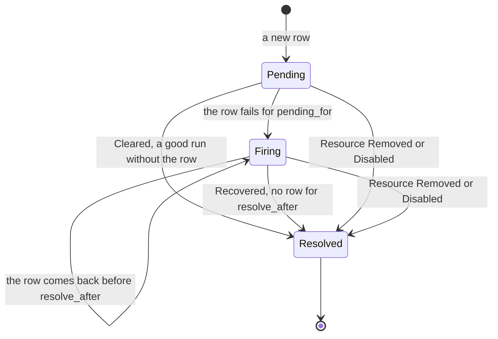

# Alerts

## Rules

A SQL rule is one ClickHouse query that finds a cause, such as a host that is down or a disk that is almost full. It returns only failing rows. An empty result means that all is well.

Each row has these columns:

| Column | Meaning |
| --- | --- |
| `resource_id` | The resource that fails, as Datum names it. |
| `alert_key` | The check inside the rule, such as a disk path. Use `''` when the rule has one check. |
| `value` | A number that shows how bad it is. |
| `detail` | One line that a responder can read. |
| `severity` | Optional. `Low`, `Medium`, `High` or `Critical` for this row. |

A pair of `resource_id` and `alert_key` occurs one time. A duplicate pair, a missing column or more than 50,000 rows fails the whole query.

Keep rules few. Each rule must point to one fix. Put a family of checks, such as all disk checks of a host, in one rule, and use the check name as the `alert_key`. Do not add a rule for one site or one VM when its own layer already tells its owner.

### Header

The lines at the top of the file set the rule fields:

```sql
-- title: Host disk almost full
-- severity: High
-- resource_type: Metal Host
-- runbook_url: https://example.com/runbooks/host-disk-full.md
-- interval: 300
-- pending_for: 300
-- resolve_after: 600
SELECT ...
```

| Field | Meaning |
| --- | --- |
| `severity` | The highest severity of the rule. A row can set a lower one. |
| `resource_type` | The registry type of the resources in the rows, such as `Metal Host`. When the rows can have more types, write a list, such as `Metal Host, Virtual Machine`. Beacon shows it and does not use it to match rows. |
| `interval` | Seconds between two runs. |
| `pending_for` | Seconds a row must fail before the alert fires. It must be at least `interval`, so an alert fires at the earliest on the second failing run. |
| `resolve_after` | Seconds without a row before a firing alert recovers. |
| `scope_includes_descendants` | 1 when the incident must cover everything under the resource, such as the VMs of a host. |
| `runbook_url` | The URL of the responder steps. Each High or Critical rule must have one. The sync warns about each one without it. |

### Severity

| Severity | Use it for |
| --- | --- |
| Critical | Customers are down now, and a person must act at once. |
| High | Customers are or will soon be affected. It pages. |
| Medium | A person must look today. Chat and email. |
| Low | Something to know about. Chat only. |

Use the `severity` column when one rule has a soft limit and a hard limit. For example, a disk with less than 25% free is Low, and with less than 10% free it is High.

A Pending alert takes the severity of its current row. A Firing alert only goes up in severity, and then it stores the value and detail of the row that made it worse.

### HTTP and TLS rules

An HTTP rule is a file with only header lines: a URL, a region and the expected status or text. A TLS rule has a host and the minimum days left on its certificate. Each minute, the region run checks the endpoint from the Beacon site and raises or resolves an alert on the region resource.

A TLS rule fails when the connection or the handshake fails, when the certificate does not verify for the host, or when fewer days are left than the minimum.

The region header names one region, or `all` for every active region. Each region then has its own alert.

The URL and the host can use these variables. Beacon fills them in for each region:

| Variable | Value |
| --- | --- |
| `{region}` | The region name. |
| `{wildcard_domain}` | The Wildcard Domain of the region. |
| `{atlas_url}` | The scheme and host of the Base URL of the region's `atlas` Resource Source. |
| `{central_url}` | The Central URL in Beacon Settings. |

When a variable has no value in a region, Beacon logs an error and skips the rule there. The alert keeps its state, as after a failed query.

## One evaluation

Each minute, Beacon queues one job for each region that has due rules. For each due rule in that region, it does these steps:

1. When the region is Unreachable, skip the rule. The region alert covers it.
2. Run the query as the read-only `beacon` user, with a time limit.
3. When the query fails, add 1 to the error count and stop. Nothing changes. After 3 errors in a row the rule is Broken, and the control panel shows it in red.
4. When the last good run is older than 3 intervals, restart the pending and clean timers, because the time is no longer continuous.
5. Drop the rows of unknown resources, of resources that are not checked, and of resources that are new in the last 10 minutes.
6. Compare the rows with the open alerts and write only the changes.
7. When an alert starts firing or becomes more severe, make sure that it belongs to an incident. When alerts recover, a separate job checks whether their incident can close.

## Alert states

One alert is one problem on one resource, from its start to its end. Beacon writes the alert only when its state changes.



A query error or an Unreachable region changes no state. A Resolved alert stores its resolution: Cleared, Recovered, Resource Removed or Disabled.

| From | Event | To |
| --- | --- | --- |
| none | A new row | Pending. A built-in rule with `pending_for` 0, such as Region unreachable, fires at once. |
| Pending | The row fails for `pending_for` | Firing |
| Pending | A good run without the row | Resolved (Cleared) |
| Firing | No row for `resolve_after` | Resolved (Recovered) |
| Firing | The row comes back before `resolve_after` | Firing, and the clean timer stops |
| Pending, Firing | The query fails, or the region is Unreachable | No change |
| Pending, Firing | The resource is removed or no longer checked | Resolved (Resource Removed) |
| Pending, Firing | The rule, the region or monitoring of the resource is disabled | Resolved (Disabled) |

A query error never resolves an alert. A Resource Removed alert is not a recovery.

Beacon keeps Cleared alerts for 7 days and other resolved alerts for 90 days.

## Suppression

A suppressed alert keeps its state, but it does not join an incident and does not page. Beacon computes suppression when the alert starts, and again each minute in the region run.

An alert is suppressed when:

- an active silence matches its rule, alert key or resource, or
- an In Progress maintenance covers its resource, and for 10 minutes after the maintenance ends, so rebooted hosts can come back, or
- the maintenance has "Mute SLO Burn" set, and the alert is a burn alert of a region in the maintenance, or
- the resource has a held removal: the last resource list would remove more than 10% of the resources, and an admin must apply it.

## Region health

Each minute, the region run probes ClickHouse. After 2 failed probes, the region is Unreachable. Beacon raises one Critical alert, "Region unreachable", skips the rules of the region, and shows its services as Unknown.

When more than half of the hosts that Atlas syncs are silent in Datum, the region is Suspect. Rules still run, and the services show as Unknown. After 2 good checks the region is OK again.
