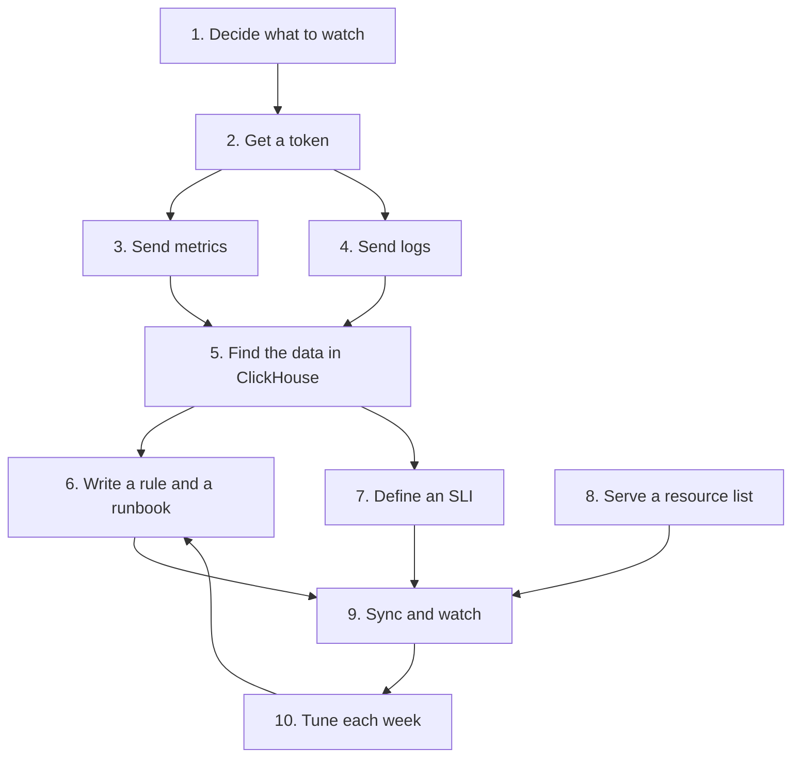
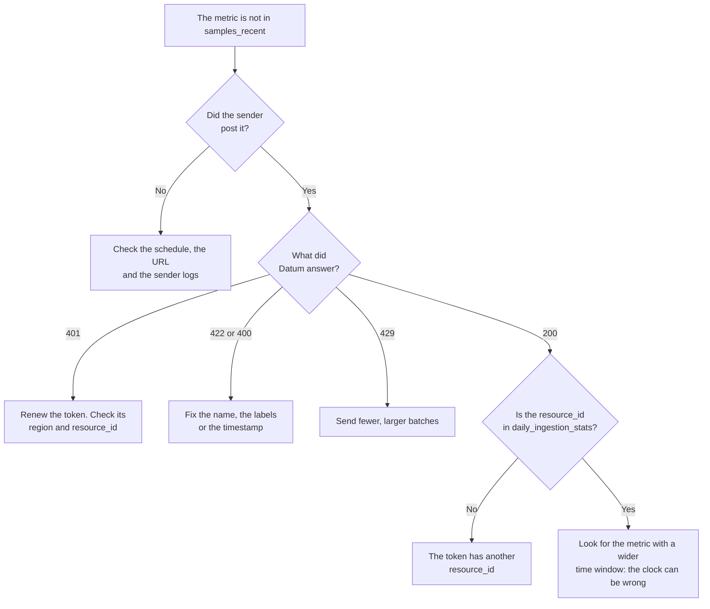

# Developer guide

This guide tells a service team how to connect a service to Datum and Beacon. Read [Telemetry](telemetry.md) first for the data path. Read [Alerts](alerts.md) and [Services and SLOs](services.md) for what Beacon does with the data.



Most services need steps 1 to 6 and 9. Do step 7 when customers use the service. Do step 8 when the service runs infrastructure.

## 1. Decide what to watch

Write down the answer to two questions before you write code.

1. **What do customers see when this service fails?** That is the symptom. Measure it as good events and valid events, such as requests that did not fail with 5xx. The symptom becomes the SLI. A fast burn of its error budget pages. See [burn-rate alerts](services.md#burn-rate-alerts).
2. **What breaks, and what is the fix?** That is the cause. A cause rule names the broken part, such as a full disk or a stuck queue, so the responder knows where to start.

Send counts, not items. When your service watches many things, send how many there are and how many fail. A site, a VM, a request, a job or a user is never a label value. A host, a queue or a gateway can be a label value, because there are few of them. Each label value makes one more series for each sample, and series cost storage and query time.

For example, Pilot sends one gauge for each site state on each VM:

```text
pilot_sites{state="up"}            398
pilot_sites{state="down"}            1
pilot_sites{state="maintenance"}     1
```

## 2. Get a token and a resource

The token names the resource ID of the sender, as the [contract](telemetry.md#resource-ids) sets. Datum writes it on each row. A machine sends with the name of its Atlas Virtual Machine or Metal Server, and an application with its own name.

| Issuer | Where the code is |
| --- | --- |
| Atlas | `issue_datum_token` in `atlas/atlas/core/telemetry/datum.py` |
| Cargo | `issue_datum_token` in `cargo/issuer.py`, for the Cargo site, the Pilot of the Cargo VM and the Cargo machines |
| Central | `mint_datum_token` in `central/sso.py`, for a Pilot VM and for Central |

A new Frappe app that runs in a region asks the issuer that already trusts it. Do not make a new key set. Renew the token before it expires. A token for one region does not work in another region.

Beacon keeps only the rows whose resource ID is in its registry. Before you rely on a rule or an SLI, make sure that the resource list of the region (step 8) gives the resource with the same ID.

## 3. Send metrics

### Name the metric

Use `namespace_subsystem_target_unit_suffix`, in lowercase with `_`:

| Part | Example | Rule |
| --- | --- | --- |
| namespace | `cargo` | The product. One namespace for each product. |
| subsystem | `object_storage` | The part of the product. |
| target | `backup_age` | What you measure. |
| unit | `seconds`, `bytes`, `percent` | A base unit. Use seconds, not minutes. Use bytes, not MB. |
| suffix | `total` | Only for a counter. `datum_client` adds it. |

Choose the type:

| Type | Use it for | Example | Read it with |
| --- | --- | --- | --- |
| Gauge | A value that goes up and down: a size, a queue length, an age, a count of items in a state | `central_job_queue_length{queue}` | `latest_value` |
| Counter | A value that only goes up, from process start | `service_proxy_requests_total{status_class}` | `counter_increase` |

A counter that goes down is a restart. `counter_increase` counts a drop as a reset. Do not send an increment as a counter. Send the total so far.

### Send all values of one collection with one timestamp

When a collection sends many series, give them all the same `ts`. A rule can then read only the newest collection. If a series stops, because its problem cleared, the rule does not see its old value.

```sql
WITH (SELECT max(ts) FROM datum.samples_recent
      WHERE metric = 'central_job_queue_length' AND resource_id = 'central'
        AND ts > now() - INTERVAL 10 MINUTE) AS snapshot
SELECT ... FROM datum.samples_recent WHERE ... AND ts = snapshot
```

This is a template: put your filters in place of `...`. Pick a metric for `snapshot` that each collection always sends. Send 0 for a state with no items, when a rule reads the state.

### Send from Python

`datum_client` builds valid names and posts batches. It never raises on a network failure, and it never retries.

```python
from datum_client import Batch, Datum

batch = Batch("cargo", "object_storage")
batch.gauge("backup_age", age_seconds, unit="seconds", cluster="garage-1")
batch.counter("backups", completed, cluster="garage-1")  # cargo_object_storage_backups_total

with Datum(url, token) as datum:
	datum.send(batch)
```

A Frappe app can also post the JSON body itself from a scheduled job. Send each minute at most. Read the result: a 4xx means that the batch is not valid, and Datum stored nothing.

```python
requests.post(
	f"{url}/v1/ingest", json={"samples": samples}, headers={"Authorization": f"Bearer {token}"}, timeout=10
)
```

Keep the data of a failed push when you can send it again without a duplicate, such as a count that you read and reset. Put it back and send it with the next push.

### Send from a Prometheus exporter

When the service already shows Prometheus metrics, add a role file to the [Datum agent](telemetry.md#the-datum-agent) that scrapes them into a `metrics_<name>` transform. Rename each metric to the contract. Drop histogram buckets. Keep only `_sum` and `_count`, or a batch gets too large.

### Check the budget

| Check | Limit |
| --- | --- |
| Requests for each resource ID and endpoint | 12 in 60 seconds |
| Samples in one request | 10,000 |
| Labels on one sample | 64 |
| Series | Few. Count the label values: a label with 1,000 values makes 1,000 series. |

## 4. Send logs

Obey the [log lines](telemetry.md#log-lines) of the contract. A machine with the Datum agent already sends its journal. For a log file, add a `logs_<name>` transform to the role file. A Frappe app sends its Error Logs from a scheduled job with `source = 'error_log'`, as Atlas, Cargo and Central do. Store the cursor before the first push. Move it only after Datum accepts the lines.

## 5. Find the data in ClickHouse

Run these queries on the ClickHouse of the region. Use the newest minutes, and replace the names.

```sql
-- Does Datum get anything from this sender today?
SELECT date, resource_id, sum(metric_count) FROM datum.daily_ingestion_stats
WHERE date = today() AND resource_id = '<virtual machine>' GROUP BY date, resource_id;

-- Which series does it send, and when was the last sample?
SELECT metric, labels, max(ts), argMax(value, ts) FROM datum.samples_recent
WHERE resource_id = '<virtual machine>' AND ts > now() - INTERVAL 10 MINUTE
GROUP BY metric, labels ORDER BY metric;

-- Is the clock of the sender correct? The age must be a few seconds to a few minutes.
SELECT resource_id, dateDiff('second', max(ts), now()) AS age FROM datum.samples_recent
WHERE metric = 'cargo_object_storage_health' AND ts > now() - INTERVAL 1 DAY GROUP BY resource_id;
```

When a metric does not show up, do these checks in order:



## 6. Write a rule and a runbook

Add a rule only when it points to one fix. Each rule is one file, `beacon/rules/<rule-key>.sql`. Write the rule key, the service key, the runbook name and a fixed `alert_key` in lowercase with `-`, such as `host-disk-full`, because they are file names and parts of URLs. Metric and label names use `_`, because Datum refuses `-` in them. It returns only failing rows, with `resource_id`, `alert_key`, `value`, `detail` and an optional `severity`. The optional `-- description:` header tells the responder what broke, and the Overview tab of the incident shows it. See [Alerts](alerts.md) for the contract and the header.

### An example

```sql
-- title: Object storage backup stale
-- description: Cargo has no recent metadata backup of the object storage cluster.
-- severity: Medium
-- resource_type: Cargo Server
-- interval: 900
-- pending_for: 900
-- resolve_after: 3600
-- runbook_url: https://github.com/frappe/cargo/blob/develop/beacon/runbooks/object-storage-backup-stale.md
-- Cargo uploads the newest metadata snapshot of each cluster each hour. No backup for 1 day means a lost metadata disk loses the bucket index.
SELECT 'cargo' AS resource_id, cluster AS alert_key, age AS value,
       concat('the newest metadata backup of ', cluster, ' is ', toString(round(age / 3600)), ' h old') AS detail
FROM (
    SELECT labels['cluster'] AS cluster, argMax(value, ts) AS age
    FROM datum.samples_recent
    WHERE metric = 'cargo_object_storage_metadata_backup_age_seconds' AND resource_id = 'cargo' AND ts > now() - INTERVAL 3 HOUR
    GROUP BY cluster
)
WHERE age > 86400
```

### Choose the times

The [header fields](alerts.md#header) say what each time does. Choose them like this:

| Field | How to choose it |
| --- | --- |
| `interval` | How often the data changes. A metric sent each minute needs 60. A daily job needs 900 or more. |
| `pending_for` | How long the problem must stay before a person must know. Use 3 to 10 minutes for a page. |
| `resolve_after` | At least 2 intervals, so the alert does not flap. |

### Choose the severity

Page only for customer impact. A page at night must be worth the call. Use the [severity table](alerts.md#severity). Critical continues to page until a person acknowledges, so use it rarely.

Return a `severity` column when one rule has a soft limit and a hard limit. Set the header to the highest severity that a row returns, because the runbook check reads the header.

### Use these patterns

- **Silence.** Start from a list of what must report, such as `daily_ingestion_stats` of the last 14 days or the inventory that Atlas sends. Join the last sample. A missing sample is silent. A rule that starts from the samples resolves when the samples expire.
- **Rate, not count.** Compare failures with the total, such as 5 failed of at least 20 attempts. A count alone pages on busy days and misses quiet failures.
- **The newest collection.** Read only `ts = snapshot` of the newest collection. See step 3.
- **Noise.** Leave out errors that the caller causes, such as permission errors, 403 and 404. Leave out what another rule covers.

### Avoid these ClickHouse mistakes

- **An alias replaces a column.** `SELECT 'cargo' AS resource_id ... WHERE resource_id IN (...)` compares the constant `'cargo'`, not the column. The same is true for `sumIf(value, ...)` when the query has `... AS value`. Filter in a subquery, or use another alias name.
- **The first `UNION ALL` branch names the columns.** Give the aliases in the first branch.
- **`samples` is slow for one metric across the region.** Read `samples_recent`.
- **A counter needs 2 samples in the window.** Make the window at least 2 send intervals.
- **A row with an unknown resource ID is dropped.** See step 2.
- **The metric name, the labels and the log fields do not say who sent a row.** Every token of the region can send any of them. Only `resource_id` comes from the token. Filter on the sender, such as `resource_id = 'atlas'` for a metric that Atlas sends. Take a resource ID from a label only when the sender of the label is filtered, such as the `atlas_machine` inventory of `resource_id = 'atlas'`.

### Test the rule before you merge it

Run the query on a ClickHouse with data. `{region:String}` is the region name. `{excluded:Array(String)}` is the list of resource IDs in the region with monitoring disabled. Rule and SLI queries both get them. Beacon drops the rows of such a resource after the query runs. A query that adds the data of many resources into one row must filter them itself: `resource_id NOT IN {excluded:Array(String)}`.

```sh
clickhouse-client --param_region=bom < beacon/rules/object-storage-backup-stale.sql
```

Add rows that make it fail, and check the columns and the `detail`. Remove the test rows after.

### Write the runbook

Each High or Critical rule must have a runbook. Keep it in `beacon/runbooks/<rule-key>.md` and set its URL in `runbook_url`. Beacon does not sync runbooks. The responder opens the URL from the alert, often at night. Write:

1. What failed, in one sentence, and what customers see.
2. What each `alert_key` and severity means.
3. Numbered steps: where to look, what to run, and how to fix the usual causes.
4. When to escalate, and to whom.

## 7. Define an SLI

When customers use the service, add `beacon/services/<service>.sql`. The query returns one row for each reporter: `resource_id`, `good`, `valid` and `last_ts`. [Services and SLOs](services.md) says how Beacon uses the rows. This complete example counts the S3 requests of a region:

```sql
-- title: Object Storage
-- description: S3 requests to object storage succeed.
-- scope: Region
-- slo_target: 99.9
-- sort_order: 4
SELECT 'cargo' AS resource_id, toInt64(greatest(requests - errors, 0)) AS good, toInt64(requests) AS valid, last_ts
FROM (
    SELECT (SELECT sum(increase) FROM datum.counter_increase(metric = 'garage_api_s3_request_counter', window = 180)) AS requests,
           (SELECT sum(increase) FROM datum.counter_increase(metric = 'garage_api_s3_error_counter', window = 180)
            WHERE startsWith(labels['status_code'], '5')) AS errors,
           (SELECT max(ts) FROM datum.samples_recent
            WHERE metric = 'garage_api_s3_request_counter' AND ts > now() - INTERVAL 10 MINUTE) AS last_ts
)
WHERE last_ts IS NOT NULL AND last_ts > toDateTime64(0, 3)
```

A part that customers see but that has no metric yet can be a declared service: a file with only the header and `-- measurement: Declared`. Published incidents set its status. `-- status_page_group: Networking` shows services with the same group under one heading. See [declared services and groups](services.md#declared-services-and-groups).

Count only failures that the platform causes. A failure of the customer's own app or a normal 4xx answer is good. A global service sets `scope: Global` and `query_region`, the region whose ClickHouse has its data. When that region depends on the site, leave `query_region` out and set Query Region in Desk. A global application, such as Central, is not in a resource list, so its SLI reports `{region:String} AS resource_id`, the region resource.

## 8. Serve a resource list

A regional service that runs infrastructure serves `GET <base>/beacon/resources`:

```json
{"resources": [{"resource_id": "h12", "resource_type": "Metal Host", "parent_id": "", "title": "h12", "status": "Active"}]}
```

The response has an `ETag`. Beacon signs in with the Frappe API key of a user on the service.

The status is one of Pending, Active, Suspended and Terminated. A Suspended resource gives no alerts. Use it only for a resource that is stopped on purpose, such as a sleeping VM.

Beacon marks a resource as Terminated when it is missing from 2 good fetches. When one fetch would terminate more than 10% of the resources, Beacon holds the removal, and an admin must apply it. A change to Suspended or Pending is not a removal.

## 9. Sync and watch

Each app keeps its Beacon files in `beacon/` of its own repository:

```text
beacon/
  rules/<rule-key>.sql       cause rules
  rules/<rule-key>.http      HTTP checks
  rules/<rule-key>.tls       TLS certificate checks
  services/<service>.sql     SLI queries
  runbooks/<rule-key>.md     the steps for each rule that pages
```

Add each repository as a Definition Source in Beacon Settings. Set its branch and the folder `beacon`. Select Sync Definitions to read the rule and service files. Beacon does not read the runbooks.

The sync applies all files of a source, or none. It applies none when one file has an invalid header, a name that another source owns, or a new or changed SQL query that fails.

When a rule or service file is missing, Beacon disables that record and marks it Removed From Source. Beacon enables it again when the file comes back. A source can take a name when its old source removed the file or is no longer configured. So a rule can move between repositories.

Desk can only turn a file rule or service on or off, set the Query Region of a global service, and set the Regions of an HTTP or TLS rule. A service is an Alert Rule of kind SLO Burn, so its file and its burn rule are one record. A file that names a region sets the Regions again at each sync. To change anything else, change its file.

After the sync, open the rule in Desk. A rule that fails 3 times in a row is Broken, and the control panel shows it in red. Fix it in the same week.

## 10. Tune each week

A rule that pages without a reason teaches people to ignore pages. Each week, look at the alerts of the last 7 days for each rule and ask:

| Question | When the answer is yes |
| --- | --- |
| Did it fire without a fix? | Raise the limit, make `pending_for` longer, or lower the severity. |
| Did it fire for a problem that another alert already showed? | Remove the rule or merge it into the other rule. |
| Did it flap: fire, resolve and fire again? | Make `resolve_after` longer. |
| Did customers see a problem that no alert showed? | Add a metric or a rule, or make the SLI cover it. |
| Did the responder not know what to do? | Improve the runbook. |

Change one thing at a time. Put the reason in the commit message.

## Checklist

Before you merge:

- [ ] Each metric name follows the pattern, and each counter ends in `_total`.
- [ ] No label has a value for each site, VM, request, job or user.
- [ ] One collection sends all its series with one timestamp.
- [ ] The data shows in `samples_recent` from a real sender.
- [ ] The resource ID of each rule and SLI row is in the Beacon registry.
- [ ] Each rule points to one fix, and you ran it on data that fails and data that does not.
- [ ] Each High or Critical rule has a runbook.
- [ ] `pending_for` is at least `interval`, and `resolve_after` is at least 2 intervals.
- [ ] No log line or label holds a secret.
