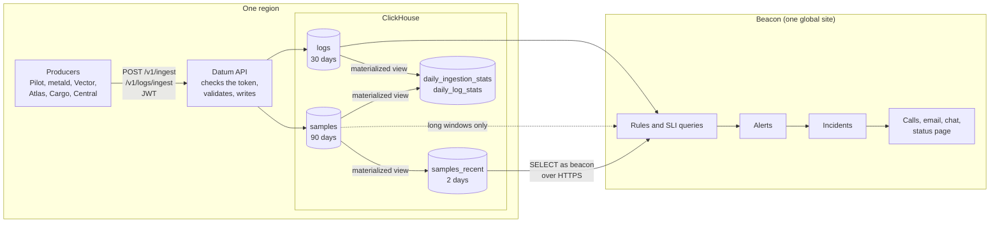
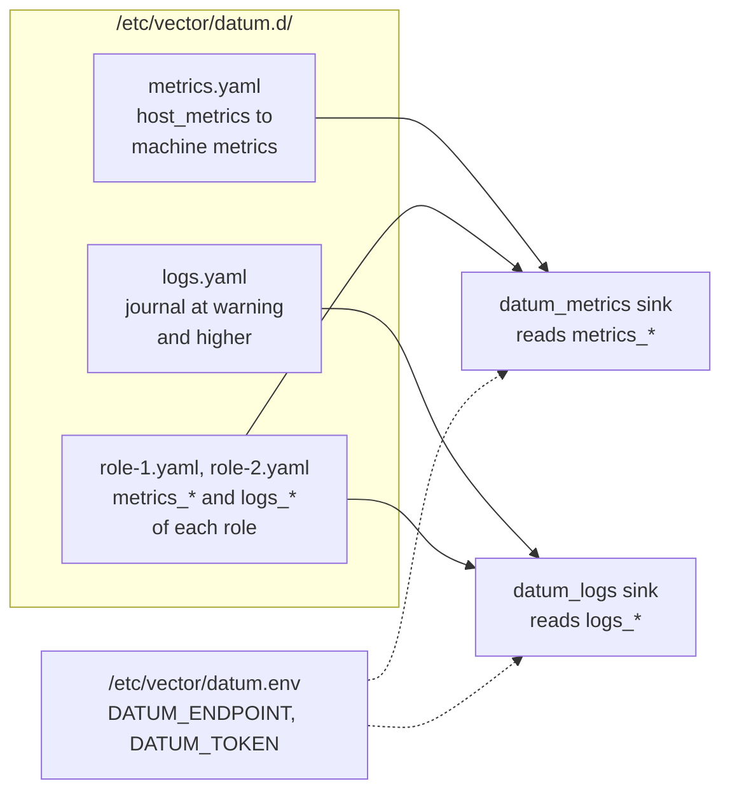

# Telemetry

This page describes how data gets from a producer to a page. Read it before you add a metric, a log or a rule. The [developer guide](integration.md) gives the steps.

## The path of one sample

1. A producer collects a value and sends it to the Datum of its region with a token.
2. Datum checks the token, validates the request and writes the rows. Datum writes the resource ID of the token on each row. The producer cannot set it.
3. Materialized views in ClickHouse copy each new sample to `samples_recent` and count it in `daily_ingestion_stats`.
4. Beacon runs each rule at its interval on the ClickHouse of each region as the `beacon` user. Each minute, it runs the SLI query of each regional service in each region, and of each global service in its `query_region`. A rule returns failing rows. An SLI returns good and valid counts.
5. Beacon turns the rows into alerts, the alerts into incidents, and the incidents into pages.

Datum only writes, and Beacon only reads. Datum owns the schema. Beacon issues no DDL and no writes.

## Producers

Each producer sends only what a rule, an SLI or a dashboard reads, and a small number of metrics that an engineer needs to investigate an alert of the producer. All other metrics and logs stay on the machine. The rules and runbooks of each producer are in `beacon/` of its own repository.

| Producer | Runs on | Sends |
| --- | --- | --- |
| metald | Each host | The machine metrics of the host, VM states, storage, hardware |
| Datum agent | Each Atlas service VM, the Cargo VM, each Cargo machine; each host for logs only | The machine metrics, logs, and the metrics of the role, such as proxy requests or Garage |
| Pilot | Each Pilot VM, and the Cargo VM | Its heartbeat, sites, backups, the database state, disk space, calls to Central, update events |
| Atlas | The Atlas site of the region | Inventory, the expected machines, jobs, API calls, Error Logs |
| Cargo | The Cargo site of the region | Image builds, object storage health and backups, Error Logs |
| Central | The global Central site | API requests, payments, resource actions, webhooks, Error Logs |

Central is global, but it sends to the Datum of one region: the Region that has **Central Telemetry Region** set in Central.

## The contract

All producers obey this contract. A rule that reads a value of the contract works for every producer. Do not add a second name for a value that the contract already names.

### Resource IDs

Each machine and each application sends with one resource ID: the ID that the Beacon registry has for it. The issuer of the token sets it.

| Sender | Resource ID | Issuer |
| --- | --- | --- |
| A host | The name of the Metal Server | Atlas |
| A VM: a Pilot VM, an Atlas service VM, a Cargo machine or the Cargo VM | The name of the Atlas Virtual Machine | Central for Pilot and a Cargo machine, Atlas for the Datum agent on an Atlas service VM and the Cargo VM |
| The Atlas site | `atlas` | Atlas |
| The Cargo site | `cargo` | Central |
| Central | `central` | Central |

A label never repeats the identity of the sender. Do not add `host`, `machine`, `region`, `role` or `cluster` labels. Datum writes the resource ID, and the registry gives the type and the parent. The owner of the machines sends their inventory each minute, so a query can find the kind, role or cluster of a machine: `atlas_machine{machine, kind}` from Atlas and `cargo_machine{machine, role, cluster}` from Cargo.

### Metric names

A name is `<namespace>_<target>_<unit>`, with `_total` at the end of a counter. The namespace is the program that the value is about:

| Namespace | Program |
| --- | --- |
| `system` | The machine: Linux on a host or a VM |
| `metal` | metald |
| `atlas`, `cargo`, `central`, `pilot`, `datum` | The application |
| `proxy`, `wireguard`, `ipv6_router` | The Atlas service on the VM |
| `garage`, `mariadb` | The service on the VM |

| Item | Rule |
| --- | --- |
| Units | `seconds`, `bytes` and `percent` (0 to 100). Do not use minutes, MB or a ratio. |
| Counter | It only goes up from the start of the process. Send the total, not an increment. The name ends in `_total`. |
| Gauge | It goes up and down. Send 0 for a state with no items, when a rule reads the state. |
| Information | `<namespace>_<thing>_info` with the value 1 and the facts as labels. |
| Labels | Lowercase with `_`. Few values: a label with 1,000 values makes 1,000 series. |
| Time | All samples of one collection have the same `ts`. |

### Machine metrics

Each host, Atlas service VM, Cargo machine and the Cargo VM sends these metrics at least once each 60 seconds, with these names and labels. metald sends them for a host, and the Datum agent for a VM. A tenant VM sends no machine metrics. Pilot sends only `system_filesystem_size_bytes` and `system_filesystem_available_bytes` for a Pilot VM, each 5 minutes. A producer can send more `system_` metrics, but only with a name that no other producer uses for another value.

| Metric | Type | Labels |
| --- | --- | --- |
| `system_boot_time_seconds` | Gauge. The heartbeat of the machine. | |
| `system_cpu_count` | Gauge | |
| `system_cpu_seconds_total` | Counter | `cpu`: a CPU number, or `all` for the total of all CPUs, which metald sends for a host. `mode`: a field of `/proc/stat`, such as `user`, `idle` or `iowait`. Linux counts `guest` in `user` too, so metald and the Datum agent do not send `guest` and `guest_nice`. |
| `system_load_average` | Gauge | `window`: `5m`, `15m`. metald also sends `1m` for a host. |
| `system_memory_total_bytes` | Gauge | |
| `system_memory_available_bytes` | Gauge. `MemAvailable` of Linux. | |
| `system_memory_swap_used_bytes` | Gauge | |
| `system_filesystem_size_bytes` | Gauge | `mountpoint`, `device`, `type` |
| `system_filesystem_available_bytes` | Gauge. The space that a user other than root can use. | `mountpoint`, `device`, `type` |
| `system_disk_read_bytes_total` | Counter | `device` |
| `system_disk_written_bytes_total` | Counter | `device` |
| `system_network_receive_bytes_total` | Counter | `interface` |
| `system_network_transmit_bytes_total` | Counter | `interface` |
| `system_network_receive_errors_total` | Counter | `interface` |
| `system_network_transmit_errors_total` | Counter | `interface` |

Each minute, Atlas sends `atlas_machine{machine, kind}` with the value 1 for each machine that must send now: each Running host, and each VM that runs and does not sleep. `kind` is `host`, `service` for a tenant-0 VM, or `tenant`. The `machine-silent` rule compares this list, without the tenant VMs, with `system_boot_time_seconds`. The `pilot-silent` rule checks a Pilot VM.

### Log lines

| Field | Rule |
| --- | --- |
| `ts` | UTC, with the zone. |
| `product` | The owner of the machine or the application: `metal` on a host, `atlas` on an Atlas service VM and for the Atlas site, `cargo` on a Cargo machine, on the Cargo VM and for the Cargo site, `pilot` for Pilot, `central`. |
| `service` | The systemd unit without `.service`, `kernel`, or the name of the application. |
| `source` | `journal`, `file`, `error_log` for the Error Logs of an application, `bmc` for the event log of a BMC that Atlas reads, or `event` for one event that a program records, such as the result of a Pilot update. |
| `level` | One of `emergency`, `alert`, `critical`, `error`, `warning`, `notice`, `info`, `debug`. Datum refuses other values. |
| `message` | 8,192 characters at most. Remove secrets and signed URLs before the line leaves the machine. |
| `attributes` | Names in lowercase with `_`. No identity of the sender. |

Each host, Atlas service VM, Cargo machine and the Cargo VM sends the journal lines at `warning` and higher. A tenant VM sends no logs. Pilot sends only its update events. metald also sends its `info` lines for a host. A program that writes its errors to a file sends that file, such as the nginx error log at `error` and higher. Do not send access logs or health checks: metrics count requests. An application sends its Error Logs at `error`.

### The Datum agent

The Datum agent is Vector with one configuration. The Datum repository owns it in `datum_client/agent/`. Atlas and Cargo install it with the same script, and they add one role file for each role of the machine.

A role file names each transform that gives contract metrics `metrics_<name>`, and each transform that gives contract log lines `logs_<name>`. The sinks read every `metrics_*` and `logs_*` input, so a role file adds no sink. The owner of the machine writes a new token to `datum.env` and restarts Vector: Atlas pushes it over SSH, and a Cargo machine gets it from Central each day.

## Datum API

| Endpoint | Body | Use it for |
| --- | --- | --- |
| `POST /v1/ingest` | `{"samples": [{"metric", "value", "ts", "labels"}]}` | Metrics from code, such as a Frappe app. |
| `POST /v1/ingest/remote` | Prometheus remote write | Metrics from Vector or another Prometheus sender. |
| `POST /v1/logs/ingest` | `{"lines": [...]}` or a bare array of lines | Logs from Vector or code. |
| `POST /v1/traces` | OTLP traces | Spans. |

Each request needs `Authorization: Bearer <token>`. The limits for one request are:

| Limit | Value |
| --- | --- |
| Requests for each resource ID and endpoint | 12 in 60 seconds |
| Samples, or log lines | 10,000 |
| Labels on one sample, attributes on one log line | 64 |
| Log message | 8,192 characters |
| Metric name | 200 characters, `^[a-zA-Z_][a-zA-Z0-9_]*$`. Use lowercase: see the [developer guide](integration.md#name-the-metric). |

Datum refuses the whole request when one sample is not valid. Datum does not retry, and `datum_client` does not retry. A failed request is a gap in the data.

## ClickHouse tables and views

| Object | Contents | Sort key | Kept |
| --- | --- | --- | --- |
| `samples` | All metrics | `resource_id`, `metric`, `ts` | 90 days |
| `samples_recent` | The last 2 days of `samples` | `metric`, `ts`, `resource_id` | 2 days |
| `logs` | All log lines | `resource_id`, `product`, `service`, `ts` | 30 days |
| `traces` | Spans | | 7 days |
| `daily_ingestion_stats` | Samples for each day and `resource_id` | `date`, `resource_id` | No TTL |
| `daily_log_stats` | Log lines for each day, `resource_id`, product, service and level | | No TTL |
| `latest_value(metric, window)` | The newest value of each series in the window | | View |
| `counter_increase(metric, window)` | The growth of each counter series in the window. A drop is a reset. | | View |

A rule reads one metric across the region at its interval, often each minute. In `samples`, the sort key starts with `resource_id`, so that query reads every resource. In `samples_recent`, the sort key starts with `metric`. Read `samples_recent` for windows up to 2 days. Read `samples` only for a longer window, and filter on `resource_id` and `metric`.

Both views leave out samples more than 1 minute in the future, so a sender with a fast clock cannot keep an old value.

## The beacon user

Beacon reads with the `beacon` user. It can only select. Its `beacon_reader` profile fixes these settings, and a query cannot change them:

| Setting | Value |
| --- | --- |
| `readonly` | 2: Beacon can set its output format and query parameters, but no write. |
| `max_execution_time` | 20 seconds |
| `max_memory_usage` | 4 GB |
| `max_threads` | 4 |
| `max_result_rows` | 100,000, and the query fails above it |

The Datum migrations create the user. The deployer of Datum sets its password, and an admin copies it to the Beacon Region. Beacon reaches the ClickHouse of a region over HTTPS through the read address of that region.
