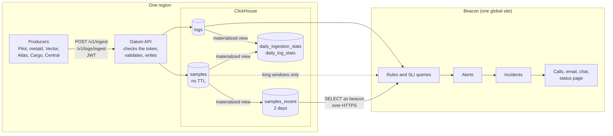

# Telemetry

This page describes how data gets from a producer to a page. Read it before you add a metric, a log or a rule. The [developer guide](integration.md) gives the steps.

## The path of one sample

1. A producer collects a value and sends it to the Datum of its region with a token.
2. Datum checks the token, validates the request and writes the rows. Datum writes the resource ID of the token on each row. The producer cannot set it.
3. Materialized views in ClickHouse copy each new sample to `samples_recent` and count it in `daily_ingestion_stats`.
4. Beacon runs each rule at its interval on the ClickHouse of each region as the `beacon` user. Each minute, it runs the SLI query of each regional service in each region, and of each global service in its `query_region`. A rule returns failing rows. An SLI returns good and valid counts.
5. Beacon turns the rows into alerts, the alerts into incidents, and the incidents into pages.

Datum only writes, and Beacon only reads. Datum owns the schema. Beacon issues no DDL and no writes.

## Producers

Each producer sends what it watches, as counts. These are examples. The rules and runbooks of each producer are in `beacon/` of its own repository.

| Producer | Runs on | Sends | Example metrics |
| --- | --- | --- | --- |
| Pilot | Each Pilot VM | Host metrics, process metrics, site states, backup results, bench logs | `pilot_sites{state}`, `pilot_site_backups{status}`, `system_disk_usage_percent` |
| metald | Each host | VM states, storage, hardware and host health | `metal_vm_wanted_running`, `metal_vm_unavailable` |
| Vector | Service nodes, Garage nodes | Host metrics, proxy request counts, Garage metrics, logs | `service_proxy_requests_total`, `garage_api_s3_request_counter` |
| Atlas | The Atlas site of the region | Inventory, sync age, jobs, API errors, Error Logs | `atlas_virtual_machine_drafts` |
| Cargo | The Cargo site of the region | Image builds, object storage health, backups, Error Logs | `cargo_object_storage_health` |
| Central | The global Central site | API requests, payments, resource actions, webhooks, Error Logs | `central_requests{group,status_class}` |

Central is global, but it sends to the Datum of one region: the Region that has **Central Telemetry Region** set in Central.

## Tokens

A token is a JWT. Its `resource_id` claim names the sender, such as one host or one VM. Datum checks the signature against one key set that holds the keys of Central and of the Atlas of each region. It accepts a token only when the audience of the token names its own region, so the Datum of another region refuses it.

| Issuer | Issues tokens for |
| --- | --- |
| Atlas | Itself and the machines of its region, such as hosts. |
| Central | Pilot VMs, Cargo and itself. |

Give each machine its own resource ID. Beacon maps the resource ID of each row to a resource of the registry, by its own ID or by its telemetry ID. Beacon drops a row with an unknown resource ID, so it gives no alert and no SLI events.

## Datum API

| Endpoint | Body | Use it for |
| --- | --- | --- |
| `POST /v1/ingest` | `{"samples": [{"metric", "value", "ts", "labels"}]}` | Metrics from code, such as a Frappe app. |
| `POST /v1/ingest/remote` | Prometheus remote write | Metrics from Vector or another Prometheus sender. |
| `POST /v1/logs/ingest` | `{"lines": [...]}` or a bare array of lines | Logs from Fluent Bit, Vector or code. |
| `POST /v1/traces` | OTLP traces | Spans. |

Each request needs `Authorization: Bearer <token>`. The limits for one request are:

| Limit | Value |
| --- | --- |
| Requests for each resource ID and endpoint | 12 in 60 seconds |
| Samples, or log lines | 10,000 |
| Labels on one sample, attributes on one log line | 64 |
| Log message | 8,192 characters |
| Metric name | 200 characters, `^[a-zA-Z_][a-zA-Z0-9_]*$`. Use lowercase: see the [developer guide](integration.md#name-the-metric). |

Datum refuses the whole request when one sample is not valid. Datum does not retry, and `datum_client` does not retry. A failed request is a gap in the data.

## ClickHouse tables and views

| Object | Contents | Sort key | Kept |
| --- | --- | --- | --- |
| `samples` | All metrics | `resource_id`, `metric`, `ts` | No TTL |
| `samples_recent` | The last 2 days of `samples` | `metric`, `ts`, `resource_id` | 2 days |
| `logs` | All log lines | `resource_id`, `product`, `service`, `ts` | No TTL |
| `traces` | Spans | | 7 days |
| `daily_ingestion_stats` | Samples for each day and `resource_id` | `date`, `resource_id` | No TTL |
| `daily_log_stats` | Log lines for each day, `resource_id`, product, service and level | | No TTL |
| `latest_value(metric, window)` | The newest value of each series in the window | | View |
| `counter_increase(metric, window)` | The growth of each counter series in the window. A drop is a reset. | | View |

A rule reads one metric across the region at its interval, often each minute. In `samples`, the sort key starts with `resource_id`, so that query reads every resource. In `samples_recent`, the sort key starts with `metric`. Read `samples_recent` for windows up to 2 days. Read `samples` only for a longer window, and filter on `resource_id` and `metric`.

Both views leave out samples more than 1 minute in the future, so a sender with a fast clock cannot keep an old value.

## The beacon user

Beacon reads with the `beacon` user. It can only select. Its `beacon_reader` profile fixes these settings, and a query cannot change them:

| Setting | Value |
| --- | --- |
| `readonly` | 2: Beacon can set its output format and query parameters, but no write. |
| `max_execution_time` | 20 seconds |
| `max_memory_usage` | 4 GB |
| `max_threads` | 4 |
| `max_result_rows` | 100,000, and the query fails above it |

The Datum migrations create the user. The deployer of Datum sets its password, and an admin copies it to the Beacon Region. Beacon reaches the ClickHouse of a region over HTTPS through the read address of that region.
